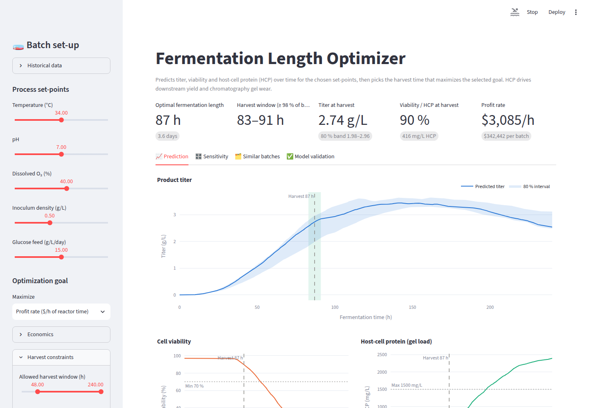
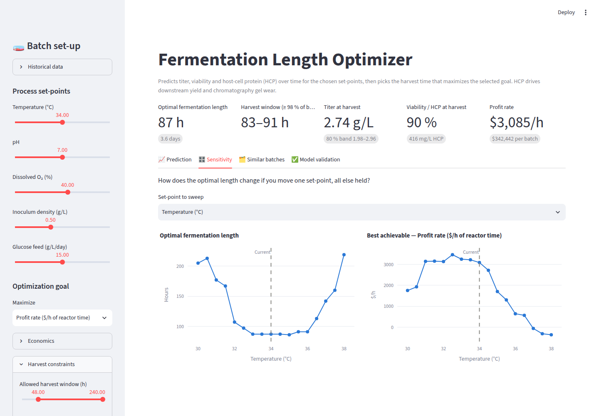
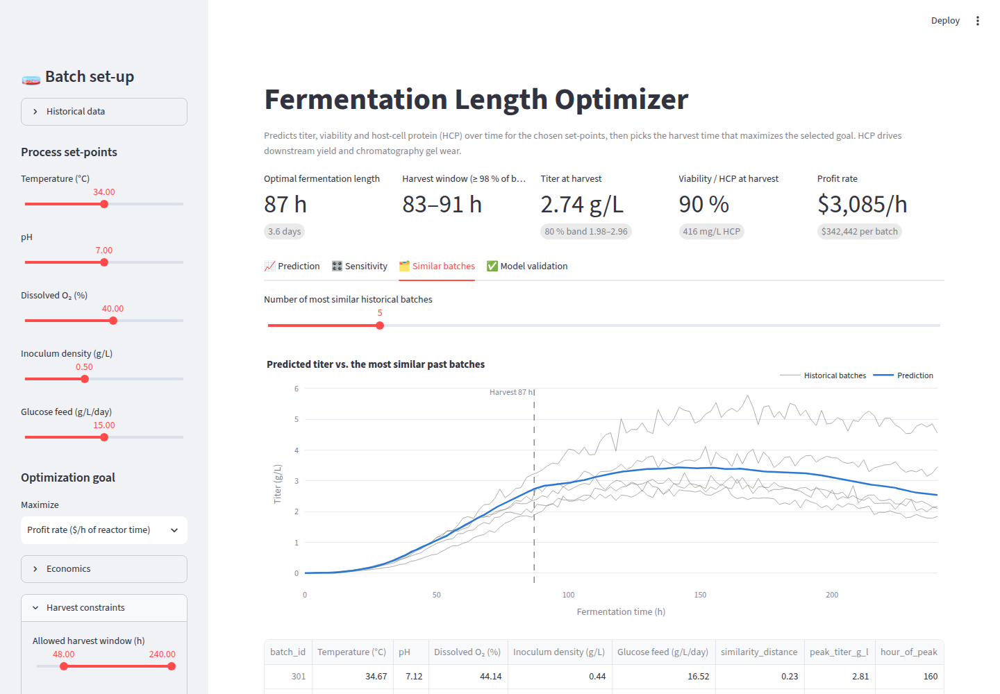
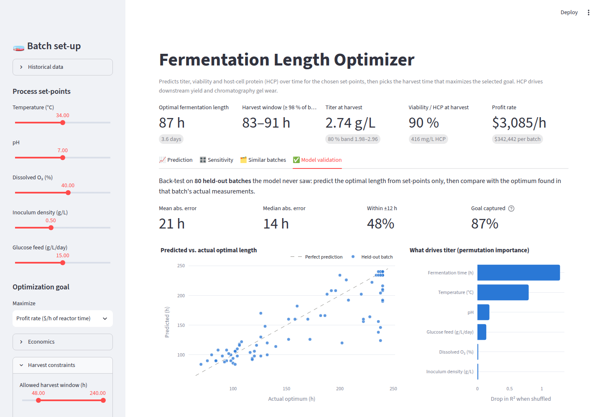

# Fermentation Length Optimizer (dashboard)

An interactive dashboard that predicts the **optimal fermentation length**
(harvest time) for a fed-batch run, balancing product titer against cell
death and host-cell protein (HCP) impurities, which cut downstream yield
and wear the chromatography gel.

## Screenshots
**Prediction**: optimal length, harvest window and predicted titer / viability / HCP curves


| Sensitivity | Similar batches | Model validation |
|---|---|---|
|  |  |  |

## How it works
1. **History**: `src/fermentation/simulator.py` generates synthetic
   historical batches (temperature, pH, dissolved O₂, inoculum density,
   glucose feed → titer, viability and HCP over time). You can also upload
   your own batch history as a CSV.
2. **Model**: `src/fermentation/model.py` trains gradient-boosting models
   that predict the titer trajectory (with an 80 % interval), viability and
   HCP for any set-points.
3. **Optimizer**: `src/fermentation/optimizer.py` scores every possible
   harvest hour (revenue × downstream yield minus operating, batch and gel-wear
   costs, divided by reactor time including turnaround). It then picks the best
   hour that meets the viability, HCP and time-window constraints.
4. **Validation**: `src/fermentation/validation.py` back-tests the predicted
   optimum against held-out batches.

## Dashboard features
- KPIs: optimal length, near-optimal harvest window, titer/viability/HCP at harvest, profit rate
- Goals: profit rate, volumetric productivity, or maximum titer
- Adjustable economics and harvest constraints
- In-process calibration: enter a sample from a running batch to correct the forecast
- Sensitivity sweep of the optimal length against each set-point
- Comparison with the most similar historical batches
- Model back-test and feature importance

## Run it
```bash
cd Tests/fermentation-length-optimizer   # every command runs from this folder
pip install -r requirements.txt
streamlit run dashboard/fermentation_dashboard.py
pytest                  # optional
python src/fermentation/simulator.py   # optional: export synthetic data to data/synthetic/
```

Running a command from another folder (e.g. your home directory) fails with
`can't open file .../src/fermentation/simulator.py`.

Uploaded CSVs need one row per sample with the columns `batch_id, temperature,
ph, dissolved_oxygen, inoculum_density, feed_rate, hour, titer, viability, hcp`.
