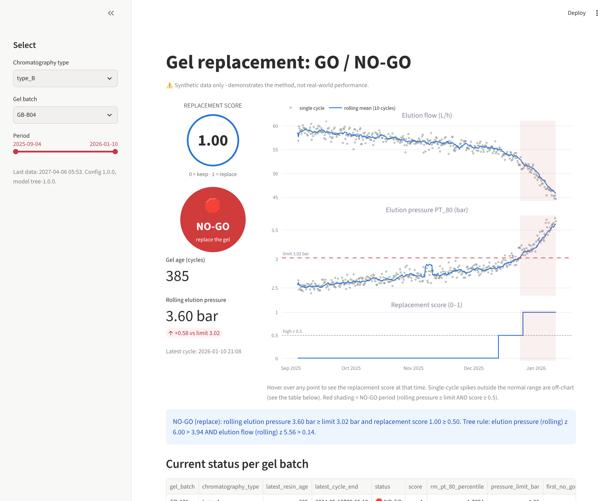

# Gel Performance Tool – GO / NO-GO for chromatography resin

> **Portfolio project built on synthetic data only.** No real process data, thresholds or company code are used.
> All numbers in this repository are invented to demonstrate a method.

Every completed chromatography cycle gets a **replacement score from 0 to 1** (0 = keep using the gel,
1 = replace it) from a small decision tree, plus a **GO / NO-GO** decision shown as a green or red light.
The inputs are the gel age and rolling means of two KPIs, elution flow and elution pressure, standardised
as z-scores per chromatography type.



**Short tour:** [`docs/walkthrough.md`](docs/walkthrough.md) explains the whole project in 5 minutes.

## Quick start

```bash
cd gel-performance-tool
python -m venv .venv
source .venv/bin/activate                      # Windows: .venv\Scripts\Activate.ps1
pip install -e ".[dashboard,train,dev]"
pytest                                         # 48 tests
python -m gel_performance.run --input data/synthetic/cycles.csv --output output --config config/config.yaml
python -m streamlit run dashboard/app.py
```

Other commands:

```bash
python -m gel_performance.simulate --out data/synthetic --seed 42   # regenerate the synthetic data
python -m gel_performance.train                                     # re-train the decision tree
python -m gel_performance.validate --out docs/validation_report.md  # compare decisions with the truth
python -m gel_performance.validate --compare-scopes --out docs/scope_comparison.md
bash scheduling/run_daily.sh                                        # the daily job, run by hand
bash scheduling/install_mac_schedule.sh                             # schedule it every morning (macOS)
```

## Project structure

```
config/config.yaml           rolling window, decision threshold, tree settings, per-type baseline and pressure limit
data/synthetic/              generated data (input + hidden truth used only for training labels and validation)
models/gonogo_tree.json      the trained decision tree as readable JSON
docs/tree_rules.txt          the same tree as if/else text
src/gel_performance/
    simulate.py              synthetic data generator
    config.py                load and check config.yaml
    data.py                  read and check the input; flag missing values, never fill them
    features.py              rolling means, per-type early-life baseline, oriented z-scores
    train.py                 fit the tree on calibration batches, save JSON + rules
    model.py                 load the JSON tree and score with it (no ML library needed)
    scoring.py               replacement score + GO / NO-GO rule
    report.py                output table with plain-English reasons, batch summary
    run.py                   command-line entry point, logging, atomic writes
    validate.py              compare decisions with the simulator's truth on held-out batches
    feed.py                  simulated daily data feed
dashboard/app.py             Streamlit dashboard (reads the run outputs only)
scheduling/                  daily job and macOS (launchd) install / uninstall scripts
tests/                       pytest: known-answer, end-to-end and idempotency tests
```

## 1. Synthetic data (`simulate.py`, `data/synthetic/`)

| File | What it holds | Seen by the scoring tool? |
|---|---|---|
| `cycles.csv` | One row per cycle: `gel_batch`, `chromatography_type`, `resin_age`, `cycle_end_time`, `elution_flow_median`, `pt_80_percentile` (+ two displacement-phase columns the tool does not use) | **Yes** (the input) |
| `true_replacement.csv` | Per gel batch: where wear accelerates and the **true replacement cycle** | No – only for training labels and validation |
| `cycles_truth.csv` | Per cycle: hidden noise-free degradation and which data problem was injected | No |

- 12 gel batches (6 per chromatography type), 313–408 cycles each, 4,396 cycles, one cycle every 6–10 hours.
- **Ageing:** slow drift, then faster wear after a batch-specific "knee". Pressure rises, flow falls.
- **Batch differences:** each lot starts ±5% different and ages at its own pace. **Noise:** ~2% per run.
- **Different baseline per type:** `type_B` runs at about 2× the pressure and half the flow of `type_A`.
- **True replacement point:** the first cycle where the noise-free pressure is 25% above the batch's own start.
- **Data problems on purpose:** 3% interrupted runs with missing values, and 16 single-cycle sensor spikes.

## 2. Features (`features.py`)

The tree uses three standardised features per cycle:

| Feature | How it is built |
|---|---|
| `z_resin_age` | (gel age − mean age in the reference window) / 100 |
| `z_rm_elution_flow_median` | rolling mean of elution flow, as an oriented z-score |
| `z_rm_pt_80_percentile` | rolling mean of elution pressure (PT 80th percentile), as an oriented z-score |

1. **Rolling mean** of each KPI over the last 10 cycles **of the same gel batch**. It smooths run-to-run noise.
   A missing value is left out of the average, never filled in.
2. **Reference window:** the first 30 cycles of every gel batch = "fresh resin". Centre and spread come from the raw
   KPI values there (mean / standard deviation, or median / MAD with `method: robust`).
3. **Oriented z-score:** `z = sign × (rolling mean − centre) / spread`, with sign +1 for pressure and −1 for flow,
   so **a higher z always means "worse"**. z is capped at ±6.
4. **Gel batch** is used to compute the rolling means and to pick a batch on screen. It is **not** a model input:
   a tree would just memorise batch names and fail on any new batch.

**Why standardise per chromatography type?** Fresh type_B resin runs at 2.70 bar and fresh type_A resin at 1.21 bar.
Compared on one scale, every type_B cycle would look "high pressure = worn". Per-type z-scores compare each cycle
with fresh resin *of the same type*, which is also what lets **one** decision tree serve both types.

`reference.scope` chooses one baseline per type (`pooled`, default) or each batch against its own start (`per_batch`).

## 3. Replacement score and GO / NO-GO (`train.py`, `model.py`, `scoring.py`)

**The decision tree** (depth 3, at least 20 training cycles per final rule) is trained once with scikit-learn on the
**calibration batches only** (odd numbers: GB-A01, A03, A05, B01, B03, B05). Training label: "replace" if the true
replacement point is 25 cycles away or less, or already passed. It is saved as readable JSON, and scoring walks
that JSON without any machine-learning library. The trained tree ([`docs/tree_rules.txt`](docs/tree_rules.txt)):

```
if elution pressure (rolling) z <= 3.94:
    if elution flow (rolling) z <= 2.68:
        if gel age z <= 2.84:
            -> score 0.01  (10 of 1608 training cycles were 'replace')
        else:  # gel age z > 2.84
            -> score 0.50  (20 of 40 training cycles were 'replace')
    else:  # elution flow (rolling) z > 2.68
        -> score 1.00  (27 of 27 training cycles were 'replace')
else:  # elution pressure (rolling) z > 3.94
    if elution flow (rolling) z <= 0.14:
        -> score 0.75  (15 of 20 training cycles were 'replace')
    else:  # elution flow (rolling) z > 0.14
        -> score 1.00  (432 of 432 training cycles were 'replace')
```

**Replacement score (0–1)** = the share of training cycles in the same final rule that were "replace" cases.
It moves in steps because a tree has a small number of final rules.

**Decision:**

| Rolling elution pressure ≥ type's limit? | Score ≥ 0.5? | Decision |
|---|---|---|
| yes | yes | 🛑 **NO-GO** – replace the gel |
| yes | no | ✅ GO – reason says "check the run / sensor" |
| no | yes | ✅ GO – reason says "keep watching" |
| no | no | ✅ GO |

Pressure limits (synthetic, about 12% above fresh resin): type_A 1.36 bar, type_B 3.02 bar.
A cycle without enough data in the rolling window gets **NO SCORE** (flag `insufficient`). One whose own values
were missing but whose rolling window still had data is scored and flagged `incomplete`.

**Output** (`output/cycle_scores.csv`), one row per cycle: decision, score, flag, a plain-English reason, rolling
KPIs, pressure limit, z-scores, the exact tree rule followed, and the config and model versions. Example reason:

> NO-GO (replace): rolling elution pressure 1.48 bar >= limit 1.36 bar and replacement score 1.00 >= 0.50.
> Tree rule: elution pressure (rolling) z 4.44 > 3.94 AND elution flow (rolling) z 2.41 > 0.14.

## 4. Running it every day

`scheduling/run_daily.sh` runs two steps:
1. **`feed.py`** releases the synthetic data day by day into `data/live/cycles.csv`, like a plant historian would.
   Day 1 holds 150 days of history and every real day adds 7 more days of plant data. The content depends only
   on today's date, so running twice on the same day changes nothing.
2. **`run.py`** scores `data/live/cycles.csv` into `output/`, which the dashboard reads.

On a Mac, `bash scheduling/install_mac_schedule.sh` registers the job with **launchd** (built into macOS) to run every
day at 07:10, or when the Mac wakes up if it was asleep. Remove it with `bash scheduling/uninstall_mac_schedule.sh`.
Logs: `output/run.log` and `output/launchd.log`. Restart the feed with `python -m gel_performance.feed --reset`.

**Built to be scheduled:** idempotent outputs (no timestamps inside, fixed sort order; tested), atomic writes (a crash
never leaves half a file), every run logged (input fingerprint, rows read, incomplete cycles, decisions per batch,
errors), and exit codes `0` OK, `1` config or model problem, `2` input data problem, `3` unexpected error.

## 5. Dashboard (`dashboard/app.py`)

```bash
python -m streamlit run dashboard/app.py
```

- **Side panel:** the latest replacement score (0–1) and a large **green GO / red NO-GO**, with icon and word (never
  colour alone), plus gel age and rolling pressure against the limit.
- **Main chart, time on the x-axis**, three panels sharing that axis:
  elution flow and elution pressure (single cycles as grey dots, rolling mean as a line, pressure limit as a red
  dashed line) and the replacement score as a step line. NO-GO periods are shaded red.
- **Hover** over any point to see the time, the value, the gel age and **the score at that moment**.
- The score sits in its own panel rather than on top of the flow, because flow (L/h) and score (0–1) have different
  units and one of them would be squashed flat on a shared axis.
- Tables: current status per gel batch, and all cycles of the selected batch. Link to a batch: `?batch=GB-B04`.

## 6. Validation (`validate.py`)

> **Synthetic data:** the truth was built into the simulator by me, so these numbers show the *method* behaves
> sensibly. They say **nothing** about performance on a real process.

The tree was trained on the odd-numbered batches. **Held-out batches (never seen by the tree)**, comparing NO-GO
with the true "replace" period ([`docs/validation_report.md`](docs/validation_report.md)):

| | type_A | type_B |
|---|---|---|
| Cycle-level agreement | 95.1% | 92.5% |
| Balanced accuracy | 91.2% | 91.8% |
| True "replace" cycles caught by NO-GO | 85.3% | 90.7% |
| NO-GO decisions that were right | 84.9% | 75.3% |

| gel batch | true replacement | first NO-GO | warning (cycles) | note |
|---|---|---|---|---|
| GB-A02 | 348 | 283 | 65 | caused by a single pressure spike; lasting NO-GO from cycle 309 (39 cycles warning) |
| GB-A04 | 340 | 310 | 30 | |
| GB-A06 | 352 | 355 | −3 (late) | lot started at low pressure |
| GB-B02 | 363 | 233 | 130 (too early) | caused by a single pressure spike; lasting NO-GO from cycle 300 (63 cycles warning) |
| GB-B04 | 338 | 333 | 5 | |
| GB-B06 | 278 | 237 | 41 | |

On the calibration batches the same figures are 97–99%: that is what the tree was trained on, which is why only the
held-out numbers count.

**How to read this honestly:**
- **A single sensor spike causes a false NO-GO.** In GB-A02 and GB-B02 the first NO-GO comes from one injected pressure
  spike of about 2×. It lifts the 10-cycle rolling mean above the limit for exactly 10 cycles, and the tree then also
  scores 1.00. Without those spikes, all six held-out batches would get their lasting NO-GO 5–63 cycles before the
  true point, except GB-A06. **A rolling median, or removing flagged outliers before the rolling mean, would fix this.**
- **GB-A06 is 3 cycles late** because it started at *lower* pressure than the other type_A lots, so its rolling
  pressure reached the fixed limit in bar late. A fixed limit treats every lot the same; the simulator's truth
  measures each lot against its own start.
- Switching to a per-batch baseline (`--compare-scopes`, [`docs/scope_comparison.md`](docs/scope_comparison.md))
  barely changes the first NO-GO, because the pressure limit is in bar and stays absolute.

## Assumptions and limitations

- **Synthetic data only.** The ageing curve, noise, batch effects, data problems and the "true" replacement point are
  invented. Good results here do not transfer to a real process.
- **The truth is partly circular:** it is defined by pressure, and pressure drives both the tree and the limit.
  Real resin may fail on yield, purity or peak shape first, which these KPIs do not see.
- **Few batches:** 6 per type, 3 per type for training. The tree's thresholds and the scores (shares of training
  cycles) would change with more data.
- **The tree learns from labels I defined** ("replace within 25 cycles"). A different horizon gives a different tree.
- **Rolling means are sensitive to spikes** (see validation: two false NO-GO periods) and lag a sudden change by a few cycles.
- **The baseline is recomputed on every run**, so a new batch's first cycles slightly move older z-scores.
  Same input → same output, but runs on different days are not strictly comparable.
- **The pressure limits are illustrative** (≈12% above fresh resin), not engineering limits.

## What I would change with real data

- **A real truth:** historical replacement decisions *with the reason* for each (pressure limit, yield loss, other).
  That is what the tree should learn from and be validated against.
- **Data gaps:** measure how often each KPI is missing and why. Runs aborted *because* of high pressure must raise
  their own alert, not just be smoothed over.
- **KPI definitions per chromatography type**, agreed with process experts (which phase, which sensor, which
  percentile), and quality KPIs such as step yield or peak asymmetry added where they define end of life.
- **Engineering pressure limits** from the equipment and resin specifications, per column type.
- **Versioned config and model:** `config.yaml` and `models/gonogo_tree.json` under change control with an owner and a
  review step. Both versions are already written into every output row.
- **Frozen reference baselines** in a versioned file, so scores from different days are comparable.
- **Robust smoothing** (rolling median) and an outlier flag, so one sensor spike cannot trigger NO-GO.
- **Monitoring the tool itself:** alert when the share of incomplete cycles, capped z-scores or dropped rows rises.
- **Operational fit:** read from the historian instead of a CSV, and a validated-system workflow if the tool
  supports GMP decisions.
