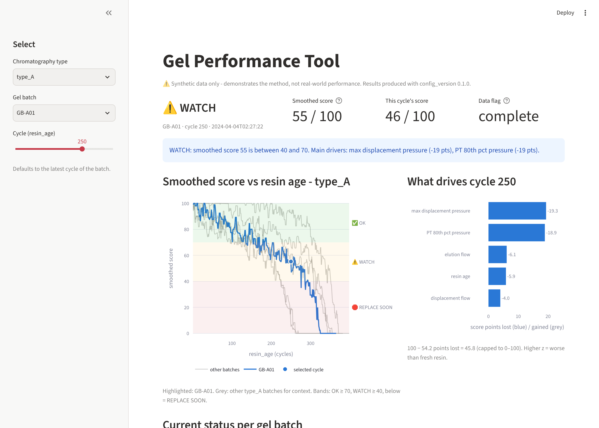

# Gel Performance Tool

> **Portfolio project built on synthetic data only.** No real process data, thresholds or company code are used.
> All numbers in this repository are invented to demonstrate a method.

For every completed chromatography cycle, the tool computes a standardised feature set, combines it into a
weighted performance score (0–100, higher = healthier gel) and recommends **OK / WATCH / REPLACE SOON**.

*(This README grows with each build step.)*

## Setup and quick start

```bash
cd gel-performance-tool
pip install -e ".[dashboard,dev]"
python -m gel_performance.simulate --out data/synthetic --seed 42          # (re)create the synthetic data
python -m gel_performance.run --input data/synthetic/cycles.csv --output output --config config/config.yaml
pytest
```

## Project structure

```
config/config.yaml           weights, reference window, score scaling, thresholds – one section per chromatography type
data/synthetic/              generated data (input + hidden truth used only for validation)
src/gel_performance/
    simulate.py              Step 1  synthetic data generator
    config.py                load and check config.yaml
    data.py                  read and check the input; flag missing values, never fill them
    features.py              Step 2  per-type reference window, oriented z-scores
    scoring.py               Step 3  weighted 0–100 score, contributions, smoothing, recommendation
    report.py                Step 3  output table with reasons, batch summary
    run.py                   Step 4  command-line entry point, logging, atomic writes
dashboard/app.py             Step 5  Streamlit dashboard (reads the run outputs only)
tests/                       pytest, known-answer and end-to-end tests
```

## Step 1 – Synthetic data (`data/synthetic/`)

Generated by `python -m gel_performance.simulate --out data/synthetic --seed 42` (fixed seed, so the files are reproducible).

| File | What it holds | Seen by the tool? |
|---|---|---|
| `cycles.csv` | One row per cycle: `gel_batch`, `chromatography_type`, `resin_age`, `cycle_end_time`, `pt_80_percentile`, `max_pressure_displacement`, `elution_flow_median`, `flow_median_displacement` | **Yes** (the input) |
| `true_replacement.csv` | Per gel batch: the "knee" where wear accelerates and the **true replacement cycle** | No (validation only) |
| `cycles_truth.csv` | Per cycle: the hidden noise-free degradation and which data problem (if any) was injected | No (validation only) |

How the fake world behaves:
- 12 gel batches (6 per chromatography type), 313–408 cycles each, 4,396 cycles in total.
- **Ageing:** a hidden degradation level grows slowly (linear) and then faster after a batch-specific knee
  (cycle 180–300). Pressures rise by that amount; flows fall at half that rate.
- **Batch-to-batch differences:** each lot starts ±5% different in pressure, ±4% in flow, and ages at its own pace.
- **Noise:** ~2% run-to-run noise, shared between the two pressures (and between the two flows), as in a real run.
- **Different baseline per type:** `type_B` runs at roughly 2× the pressure and half the flow of `type_A`.
- **True replacement point:** the first cycle where the *noise-free* pressure is 25% above the batch's starting level.
  Each batch keeps running 30–80 cycles beyond it, so we can measure late as well as early warnings.
- **Data problems on purpose:** 3% of cycles are interrupted runs with 1–3 missing features (left as blank, never filled),
  and 16 sensor-spike outliers (a pressure ×1.5–2.5 or a flow ×0.3–0.5 for a single cycle).

## Step 2 – Features and standardisation (`features.py`)

Each cycle has five features: `pt_80_percentile`, `max_pressure_displacement`, `elution_flow_median`,
`flow_median_displacement` and `resin_age`. `gel_batch` is only used for grouping and reporting, never as a number.

**1. Reference window (what fresh resin looks like).** For each chromatography type, the cycles with
`resin_age <= first_n_cycles` (30 by default, set in `config.yaml`) from *all* gel batches of that type are pooled.

**2. Centre and spread per feature** from that window, ignoring missing values:

| `reference.method` | centre | spread |
|---|---|---|
| `mean_std` (default) | mean | standard deviation |
| `robust` | median | 1.4826 × MAD (median absolute deviation) – less affected by outliers |

**3. Oriented z-score**, so that **a higher value always means "worse"**:

```
z = sign × (value − centre) / spread        sign = +1 for pressures (higher_is_worse)
                                            sign = −1 for flows     (lower_is_worse)
```

z = +2 reads the same for every feature: "two reference spreads worse than fresh resin".

**4. `resin_age` is handled differently.** Inside the reference window age only runs from 1 to 30, so its spread is tiny
and a normal z-score would reach about +20 by cycle 300 and swamp everything else. Instead:
`z_age = (resin_age − mean age in the window) / scale_cycles` – every 100 cycles (configurable) adds one unit of "worse".

**5. Capping.** Each z is capped to ±`z_clip` (6) so one sensor spike cannot dominate the score.

**6. Missing stays missing.** A missing raw value gives a missing z – never 0, never an average.

### Why standardise per chromatography type?
Different column set-ups run at different pressures and flows. In the synthetic data `type_B` runs at about twice the
pressure of `type_A` (reference centre 2.70 vs 1.21 bar). If both were standardised together, every `type_B` cycle would
look "high pressure = worn out" purely because of its set-up. Standardising per type compares each cycle only with
fresh resin *of the same type*, so a z of +2 means the same amount of wear in both.

### What it looks like on the synthetic data (average z by age band, type_A)

| resin_age | pt_80 | max_p_disp | elution_flow | disp_flow | age |
|---|---|---|---|---|---|
| 1–99 | 0.27 | 0.28 | 0.15 | 0.14 | 0.34 |
| 100–199 | 1.01 | 1.07 | 0.51 | 0.50 | 1.34 |
| 200–299 | 2.44 | 2.51 | 1.28 | 1.28 | 2.34 |
| 300+ | 4.44 | 4.50 | 2.84 | 2.82 | 3.21 |

## Step 3 – Score, contributions and recommendation (`scoring.py`, `report.py`)

All weights, the score scaling and the thresholds come from `config.yaml`, separately per chromatography type.

**Formula** (for one cycle, using its oriented z-scores `zᵢ` and config weights `wᵢ`):

```
available features   = features whose z is not missing
re-normalised weight = w'ᵢ = wᵢ / Σ(w of available features)          # weights used always sum to 1
composite            = S   = Σ w'ᵢ · zᵢ                                 # weighted "how much worse than fresh"
points lost          = ptsᵢ = 100 · w'ᵢ · zᵢ / composite_at_zero        # contribution of each feature
score                = clip(100 − Σ ptsᵢ, 0, 100) = clip(100 · (1 − S / composite_at_zero), 0, 100)
```

- A cycle that looks exactly like fresh reference resin (all z = 0) scores **100**. A cycle whose composite reaches
  `composite_at_zero` (4.0) scores **0**. Cycles better than the reference are capped at 100.
- The `pts_*` columns are the **contribution of each feature**: points it took off the score. They add up to
  `100 − score`, unless the 0/100 cap was hit. A negative value means that feature was better than reference.

Worked example (from `tests/test_scoring.py`): weights 0.4 / 0.2 / 0.2 / 0.1 / 0.1, every z = 1
→ composite 1 → score 100 × (1 − 1/4) = **75**, with 10 / 5 / 5 / 2.5 / 2.5 points lost.

**Missing features are never filled in.** If `pt_80_percentile` (weight 0.4) is missing, the other weights
0.2 / 0.2 / 0.1 / 0.1 are re-scaled to 1/3 / 1/3 / 1/6 / 1/6 and the cycle is flagged **incomplete**.
With fewer than `min_features_for_score` (3) features left, there is **no score** and the flag is **insufficient**.

**Recommendation.** The score is smoothed with a rolling median over the last `smoothing_window` (5) scored cycles
of the same gel batch, so a single noisy cycle cannot flip the advice. Then:

| smoothed score | recommendation |
|---|---|
| ≥ `ok_min` | OK |
| ≥ `watch_min` and < `ok_min` | WATCH |
| < `watch_min` | REPLACE SOON |
| no score | NO SCORE |

**Output table** (one row per cycle): identifiers, `score`, `smoothed_score`, `recommendation`, `flag`,
`missing_features`, a plain-English `reason`, `pts_*` (contributions), `w_*` (weights actually used), `z_*`,
raw features, `composite` and `config_version`. Example `reason`:

> REPLACE SOON: smoothed score 29 < 40. Main drivers: PT 80th pct pressure (-35 pts), max displacement pressure (-30 pts).
> Incomplete cycle, scored without: elution_flow_median.

A **batch summary** gives the latest status of each gel batch and the first cycle it was flagged REPLACE SOON.

> The thresholds 70 / 40 are placeholders at this point. They are chosen in Step 6 on half of the gel batches
> and validated on the other half.

## Step 4 – Running it (`run.py`) and engineering practice

```bash
python -m gel_performance.run --input data/synthetic/cycles.csv --output output --config config/config.yaml
```

| Output file | Contents |
|---|---|
| `cycle_scores.csv` | One row per cycle: score, smoothed score, recommendation, flag, reason, contributions, weights, z-scores |
| `batch_summary.csv` | Latest status per gel batch and the first cycle flagged REPLACE SOON |
| `reference_stats.csv` | The early-life baseline (centre, spread, n) used for each type and feature |
| `run.log` | Appended every run: input file and fingerprint, rows read, incomplete / insufficient counts, results, errors |

**Scheduling hourly** (example cron line; use absolute paths and always pass `--config` explicitly):

```
0 * * * * cd /path/to/gel-performance-tool && python -m gel_performance.run --input /data/cycles.csv --output /data/gel_output --config config/config.yaml
```

**Safe for a scheduler:**
- *Idempotent* – the CSV outputs depend only on the input and the config. There are no timestamps inside them, rows
  are sorted in a fixed order, and the same input (even with its rows shuffled) gives byte-identical files. Tested.
- *Atomic writes* – each file is written to a temporary name and then renamed, so a crash never leaves a half-written file.
- *Clear exit codes* – `0` success, `1` config problem, `2` input data problem, `3` unexpected error (full traceback in
  `run.log`), so the scheduler can alert on failures.
- *Nothing disappears silently* – rows dropped (unknown type, duplicate, no batch ID) and values treated as missing are
  counted in the log.

**Tests** (`pytest`, 47 tests):

| File | What it checks |
|---|---|
| `test_simulate.py` | Same seed → same data; ~3% missing; outliers present; pressures rise and flows fall with age |
| `test_config.py` | Shipped config loads; bad weights, thresholds, directions and missing features are rejected |
| `test_data.py` | Missing values flagged and not filled; text → missing; required columns; duplicates; row order |
| `test_features.py` | Known-answer reference stats and z-scores; orientation of every feature; per-type reference; capping; robust method |
| `test_scoring.py` | Known-answer score and contributions; weight re-normalisation with a missing value; too few features; every threshold boundary; smoothing |
| `test_end_to_end.py` | Full CLI run; outputs complete and consistent; run twice → identical files; shuffled input → identical files; error exit codes |

## Step 5 – Dashboard (`dashboard/app.py`)

```bash
python -m gel_performance.run --input data/synthetic/cycles.csv --output output --config config/config.yaml
streamlit run dashboard/app.py
```



- **Reads only the run outputs** (`output/cycle_scores.csv`, `batch_summary.csv`) and never recomputes scores,
  so the dashboard always shows exactly what the scheduled job produced. If there is no output yet, it shows the
  command to run.
- **Sidebar:** chromatography type, gel batch and cycle (defaults to the latest cycle). A specific cycle can be
  shared as a link, e.g. `http://localhost:8501/?batch=GB-A01&age=250`.
- **Recommendation card:** OK / WATCH / REPLACE SOON (always icon + label, never colour alone), smoothed score,
  the cycle's own score, the data flag and the plain-English reason.
- **Score vs resin age:** smoothed score per gel batch of the selected type. The selected batch is highlighted,
  the others are grey context, and the OK / WATCH / REPLACE SOON bands come from the config thresholds.
- **What drives this cycle:** points lost per feature (the `pts_*` contributions). Hover shows the oriented z-score and
  the weight actually used. Missing features are listed as missing, not shown as zero.
- **Tables:** current status per gel batch, and all cycles of the selected batch.
