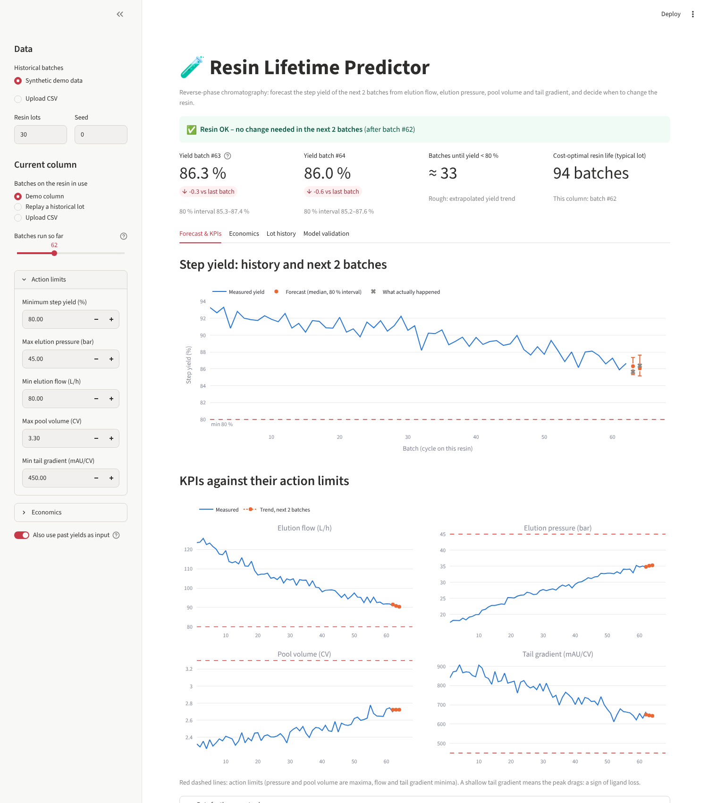
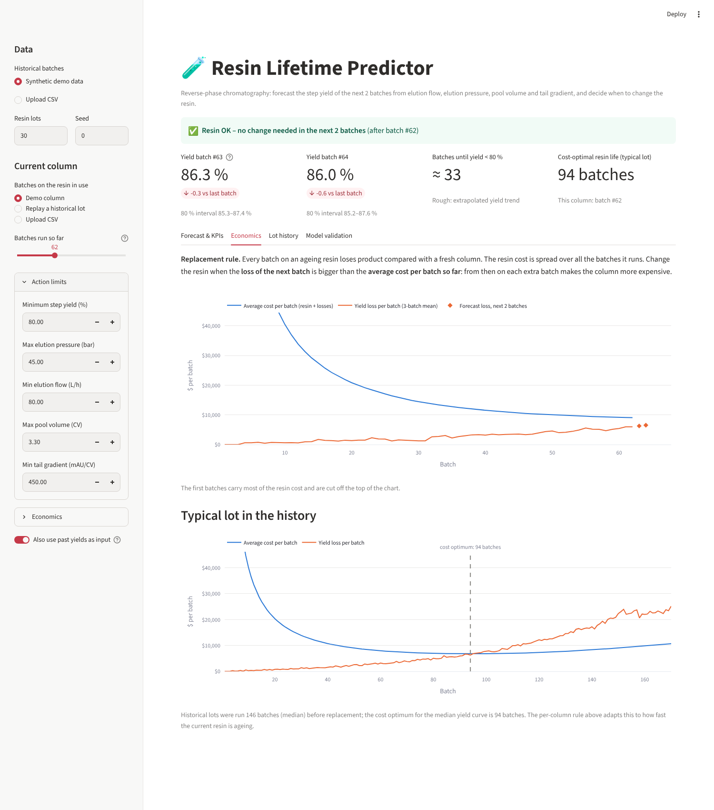
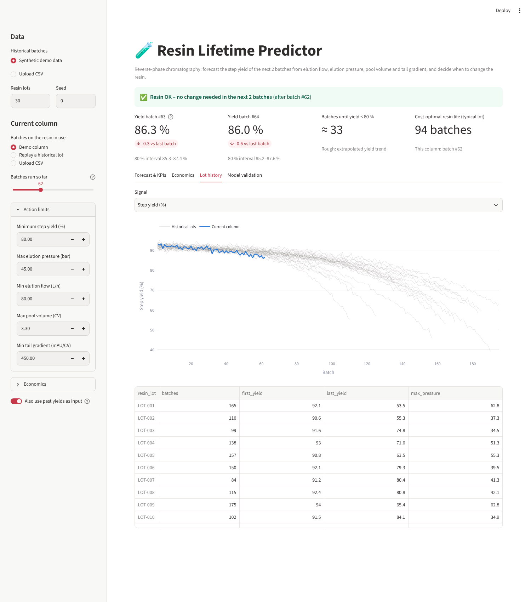
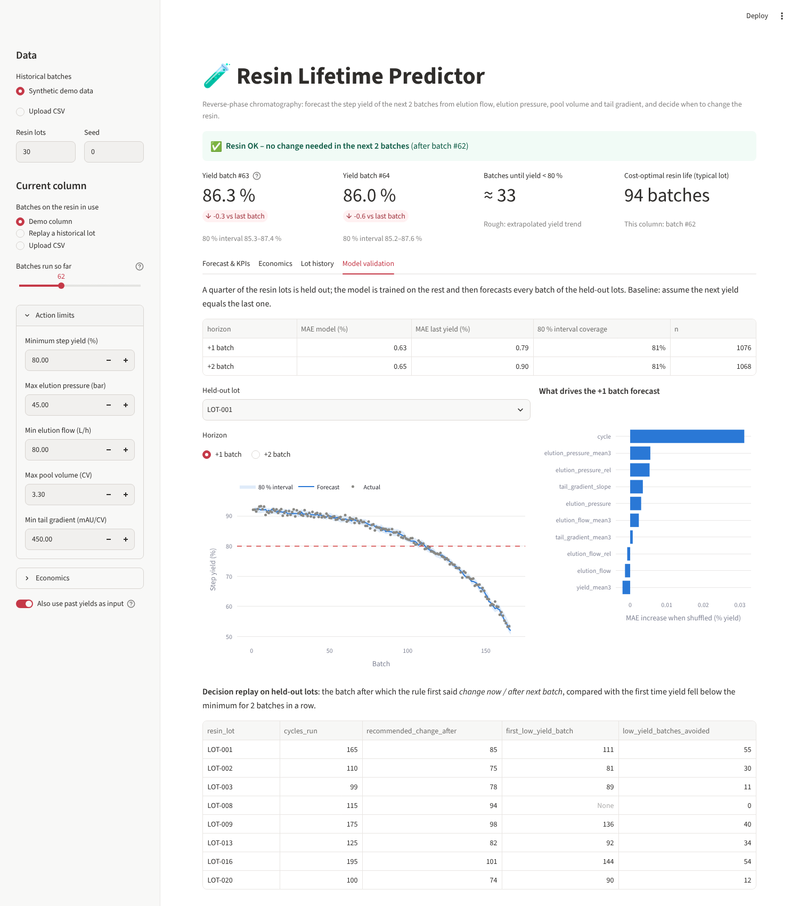

# Resin Lifetime Predictor (dashboard)

Predicts the **step yield of the next 2 batches** on a reverse-phase
chromatography column and says **when to change the resin**. It uses four KPIs
logged for every batch:

| KPI | Unit | Wear signal |
|---|---|---|
| `elution_flow` | L/h | falls as the bed fouls |
| `elution_pressure` | bar | rises as the bed fouls |
| `pool_volume` | CV | grows as peaks broaden (ligand loss) |
| `tail_gradient` | mAU/CV | steepness of the elution peak's trailing edge; falls as the peak drags |

## Screenshots
**Forecast & KPIs**: the decision, the 2-batch yield forecast and the KPIs against their action limits


| Economics | Lot history | Model validation |
|---|---|---|
|  |  |  |

## How it works
1. **History**: `src/resin/simulator.py` generates synthetic resin lots. Fouling
   is only partly removed by CIP, and ligand loss speeds up with age. Each lot
   has its own hidden lifetime. You can also upload your own data as a CSV.
2. **Features**: `src/resin/features.py` computes, for each batch, the cycle
   number and, for every KPI, the current value, the 3-batch mean, the trend
   (slope over the last 8 batches) and the ratio to the lot's first 5 batches.
   Each feature uses only that batch and earlier ones.
3. **Model**: `src/resin/model.py` uses gradient boosting with one model per
   horizon (+1 and +2 batches) and per quantile (10/50/90 %). It predicts the
   change from the recent yield, so it still works on columns older than any
   in the history. The 80 % interval is calibrated on held-out lots
   (split-conformal).
4. **Decision**: `src/resin/decision.py` takes the most urgent of three rules:
   - **Yield**: the forecast median, or the 80 % lower bound, is below the minimum yield.
   - **KPI limits**: the last 3 batches, or the linear trend over the next 2,
     cross the max pressure, min flow, max pool volume or min tail gradient.
   - **Economics**: change when the yield lost on the next batch costs more
     than the lot's average cost per batch so far (resin cost + all losses).
   The result is **OK**, **Plan a change**, **Change after the next batch** or
   **Change now**, with the reasons listed.
5. **Validation**: `src/resin/validation.py` back-tests on held-out lots
   against the "next yield = last yield" baseline. It also replays the
   decision rule batch by batch.

Back-test on the synthetic data (30 lots, 8 held out):

| Horizon | MAE model | MAE last yield | 80 % interval coverage |
|---|---|---|---|
| +1 batch | 0.63 % | 0.79 % | 81 % |
| +2 batch | 0.65 % | 0.90 % | 81 % |

If you turn off "Also use past yields" and forecast from the 4 KPIs alone, the
MAE goes up to about 1.1 %. The past yield is the strongest single input, and
the KPIs add the early warning.

## Run it
```bash
cd Tests/resin-lifetime-predictor   # every command runs from this folder
pip install -r requirements.txt
streamlit run dashboard/resin_dashboard.py
pytest                  # optional
python src/resin/simulator.py   # optional: export synthetic data to data/synthetic/
```

Uploaded CSVs need one row per batch with the columns
`resin_lot, cycle, elution_flow, elution_pressure, pool_volume, tail_gradient, yield`
(`cycle` = batch number on that resin lot, `yield` in %). Upload the full
history of past lots as one file, and the batches on the column in use as
another. Set the action limits and costs in the sidebar to match your process;
the defaults are only for the synthetic data.
